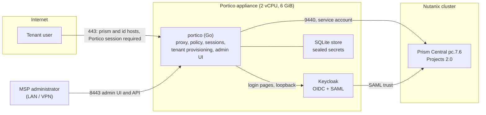

# Portico

[](https://github.com/marco-fabbri/portico/actions/workflows/ci.yml)
[](LICENSE)
[](#requirements)
[](#what-it-does)
[](go.mod)
[](#status-and-validation)

A virtual appliance that runs inside a Nutanix cluster and acts as the
**single, authenticated entry point** through which a managed service
provider's tenants reach **Nutanix Prism Central**. One Go binary fronts
Prism Central and Keycloak on two public names, lets nothing through
without a login, creates a tenant in one action and keeps platform
administration on an internal listener. Later services (Nutanix
Kubernetes Platform, Nutanix Enterprise AI) plug into the same identity
and the same tenant model.

> [!IMPORTANT]
> **Independent project.** Portico is not affiliated with, endorsed by or
> supported by Nutanix. Nutanix, Prism Central, AHV, NKP and related names
> are trademarks of Nutanix, Inc. Keycloak is a trademark of Red Hat, Inc.
>
> **No Nutanix software or documentation is distributed here.** Portico
> talks to a Prism Central you already run under your own licence, through
> its public v4 APIs; the Nutanix guides it was built against stay on the
> Nutanix portal.
>
> **Pre-release.** Portico is built in the open, milestone by milestone,
> and has no installable release yet: the appliance image is the next
> milestone. Everything below was validated on one lab cluster (see
> [Status and validation](#status-and-validation)). It is provided "as is",
> without warranty (see [License](#license)). Do not put it in front of
> customers yet.

## What it does

Portico does not replace SP Central, the service-provider layer Nutanix
ships inside Nutanix Central. It fills the gap for the small MSP that
wants to expose services to its own tenants on top of one or more Prism
Central instances, without a hyperscaler-sized control plane.
Tenants are created with the same primitive Nutanix's own SP Central uses,
a Projects 2.0 project per tenant with group-based role mapping and no
global roles: an MSP that later adopts SP Central finds tenants it
recognises. Portico is the path towards it, not a detour.

| Piece | What it does |
|---|---|
| **Public path** | `prism.<msp>.example` and `id.<msp>.example` behind a Cloudflare Tunnel or directly on port 443, same guarantees in both modes. No Portico session, no request to Prism Central: the public path fails closed, also with the identity provider down |
| **Identity** | Keycloak (OIDC for Portico, SAML for Prism Central): one login for the tenant user, MFA and brokering to the customer's directory available. Prism Central local accounts, `admin` included, can never log in from outside: every local-login path and every `Authorization` header is refused |
| **Tenant arrival** | One action creates a Projects 2.0 project with its resource group, a group in Keycloak, the SAML group and a project-scoped role membership in Prism Central, then runs a visibility check. Tenants can be disabled, enabled and deleted; users get a one-time temporary password |
| **Branding** | The Keycloak login page, Portico's landing page and its error pages carry the MSP's name, claim, colour and logo |
| **Admin path** | A web UI and a JSON API on an internal listener only, with a break-glass account; a raw pass-through to Prism Central for administrators |
| **Settings** | Stored in Portico's own database, secrets sealed with a master key the appliance creates at first start. A fresh appliance configures itself from the setup page: Portico creates its service account in Prism Central, the Keycloak realm and clients and the SAML trust from one-time credentials it never stores |



## How a request flows

1. The browser opens `https://prism.<msp>.example`. Portico looks for
   its session cookie; without one it redirects to Keycloak (OIDC
   authorization code flow) and issues its own cookie after the login.
2. With a session, the public policy runs: every `Authorization` header
   is refused, the local-login endpoints of pc.7.6 are refused, and
   Portico's own cookies are stripped before forwarding.
3. The request is proxied to Prism Central on port 9440 under the public
   host name; VM console WebSockets pass through.
4. Prism Central wants its own session: Portico's landing page starts the
   SAML login itself. Keycloak already holds a session, so the assertion
   comes back without a second login and Prism Central scopes the user
   by project membership.

Two protocols (OIDC for Portico, SAML for Prism Central), one login.

## The tenant model

A tenant is one row in Portico's store that ties together a Projects 2.0
project in Prism Central (with its resource group and the clusters and
containers it may use), a group in Keycloak (`tenant-<slug>`), a SAML
group in Prism Central and a role membership that binds the group to a
role inside the project, never a global one. Creating a tenant runs those
steps in order, records each one, and ends with a visibility check that
reads back the project and asserts the group holds nothing outside it. A
tenant can be disabled (group disabled, login impossible) and deleted; the
project is left in place unless asked, and VMs are never deleted. Tenant
users are Keycloak users of the tenant group, created from the admin UI
or API with a one-time temporary password; the email is the username and
the SAML `NameID`.

## Why "Portico"

A portico stands in front of private buildings and makes them reachable
from the public space. It is not the building, it does not replace it, and
it does not change who owns it; it has its own rules about who walks in
and what they see, and one covered walk can join several buildings. That
is Portico's relationship with Prism Central: Prism Central stays the
house, Portico is the way the tenants reach it.

The project is written in Bologna, whose porticoes are a UNESCO World
Heritage Site. The word is the same in Italian and in English, it is one
word with no vendor name in it, and `portico serve` reads well.

## What it is not

- Not a replacement for SP Central, nor for the Nutanix Central around
  it: an MSP that later adopts them finds tenants it can recognise.
- Not a second Prism Central: Portico orchestrates, it does not copy state
  it does not own.
- Not dependent on Cloudflare for security: direct exposure is as safe as
  tunnelled exposure.

## Requirements

- **Prism Central pc.7.6 or later** (Projects 2.0). Older releases use a
  different project model and are out of scope; a legacy adapter, if ever,
  would come with reduced guarantees.
- Port 9440 of Prism Central reachable only from Portico's internal
  address and the MSP management network: Portico checks what it can from
  its own address, the network enforces it.
- An account that can create users and edit authorization policies, used
  once by the setup page to create Portico's own service account; an
  administrator's credentials once more for the SAML trust, which the
  service account's role cannot create (measured, write-up 15).
- Appliance footprint target: 2 vCPU, 6 GiB RAM, 40 GiB disk for Portico,
  Keycloak, PostgreSQL and the optional `cloudflared`.

## Status and validation

Everything was measured on Prism Central pc.7.6.0.6 (AOS 7.6, single-node
AHV cluster) and Keycloak 26.3 on a Rocky Linux 9 VM, by the scripts in
`lab/` and by hand in a browser. Each row has a write-up in
[`docs/lab/`](docs/lab/) saying what was measured, on which version, and
how to measure again after an upgrade.

| Milestone | Result |
|---|---|
| 0 Lab measurements, 2026-10-17 | SAML works behind a public name (per-IdP SP metadata); the local-login endpoints of pc.7.6 recorded; six v4 calls make a tenant; the console's four API generations and the VNC WebSocket measured; a service account with an API key in `Project Manager_acp` does the whole tenant cycle (write-ups 01 to 08) |
| 1 Core binary, 2026-10-17 | A browser reaches the console only after the Keycloak login; `curl -u admin:…` and every other `Authorization` scheme get 403 from Portico; VM console WebSockets through the proxy; fail closed with Keycloak down; 8 MiB binary (write-ups 09, 10, 12) |
| 2 Tenant arrival, 2026-10-18 | Tenant created in 77 s with seven recorded steps, its user signs in once with a forced password change and sees only her project; disable locks her out; deletion leaves `_internal` unchanged. Admin UI and JSON API; MSP branding on the Keycloak login page; settings sealed in the store; a fresh appliance bootstrapped from the setup page in 41 s (write-ups 11 to 18) |
| 3 Appliance image | Rocky Linux 9 qcow2 with the CIS Level 1 Server baseline, console wizard, `cloudflared` option: **next** |
| 4 First release | Install guide, release artefacts, known limits: later |

Not verified yet: more than one Prism Central behind one Portico, tenant
API keys, brokering to a customer's own directory, brownfield projects,
any production load. Deferred findings of the reviews are listed in
[`docs/backlog.md`](docs/backlog.md).

## Security considerations

The design turns on four rules, and the code is reviewed against them
(see [`SECURITY.md`](SECURITY.md) to report a finding):

- the public path fails closed: no Portico session, no request to Prism
  Central, whatever the identity provider is doing;
- Prism Central local accounts never authenticate from outside, in any
  exposure mode;
- Portico works through its own `portico` service account and never
  stores a human administrator's credentials; the one-time credentials of
  the setup page travel in that request only;
- secrets at rest are sealed with a master key that never leaves the
  appliance (`/var/lib/portico/master.key`, mode 0600, created at first
  start).

Lab defaults that must change before any real use: the lab certificate
authority, `tls_verify: false` towards a Prism Central with a self-signed
certificate, and the break-glass password set by the lab deploy script.

## Repository layout

```
cmd/portico/          main: serve | settings import|show | admin set-password | version
internal/
  proxy/              reverse proxy, public policy, landing and error pages
  auth/               OIDC login, sessions
  idp/keycloak/       Keycloak admin client
  nutanix/            Prism Central v4 client, service-account bootstrap
  tenant/             tenant model and provisioning steps
  settings/           runtime settings, checks, bootstraps
  secrets/ store/     sealing, SQLite
  branding/           MSP branding, generated Keycloak theme
  web/ api/           admin UI (templates, HTMX) and JSON API
deploy/               systemd unit, example configuration
lab/                  scripts that drive the lab (Prism Central, VM, Keycloak)
docs/
  superpowers/specs/  the design document
  superpowers/plans/  the plan each milestone was built from
  adr/                decisions
  lab/                measurements, one write-up per question
  backlog.md          deferred findings
```

## Documentation

- [Design document](docs/superpowers/specs/2026-10-17-portico-design.md):
  intent, goals and anti-goals, architecture, security model, milestones.
- [Decisions](docs/adr/): the pc.7.6 baseline, the proxy in the Go
  binary, the API boundary and the tenant-facing pages.
- [Admin JSON API](docs/api.md) and [operating the binary](docs/operating.md):
  commands, files, setup mode, logs, backup.
- [Lab write-ups](docs/lab/): one per question, with the version and how
  to measure again; [`lab-inventory.md`](docs/lab/lab-inventory.md) lists
  what the lab holds.
- [Plans](docs/superpowers/plans/) the milestones were built from, and
  the [backlog](docs/backlog.md) of deferred findings.
- [Example configuration](deploy/portico.yaml.example) and the
  [systemd unit](deploy/portico.service).

## Roadmap

Step 1 ends with the first release: the appliance image (Rocky Linux 9,
CIS Level 1, console wizard, `cloudflared` option) and an install guide.
Step 2, in no fixed order: a setup page that lists connected services
(several Prism Central, later NKP and Nutanix Enterprise AI), tenant API
keys bound to federated identities, brokering each tenant to its own
directory (AD, Entra ID, LDAP), brownfield inventory with an exclusion
list, quotas and usage reporting, tenant self-service.

## Building and testing

Go 1.27 or later, nothing else: templates, HTMX and fonts are embedded
in the binary.

```
go build ./cmd/portico
go test ./...
```

The tests run against fakes of Prism Central and Keycloak. The lab
scripts drive the real ones and need a lab of your own;
[`CONTRIBUTING.md`](CONTRIBUTING.md) says how the project is built (plan,
test first, measure on the lab, English everywhere, no secrets).

## Supporting the project

Portico is built and measured on one lab: a single-node AHV cluster
with Prism Central pc.7.6. That is enough for the single appliance, and
not enough for what comes next. If you can help
with any of the following, it turns a design into a measurement:

- **A decommissioned Nutanix node** (NX, or a Dell XC, HPE DX, Lenovo HX
  equivalent), even an older one: out of your inventory, into the lab
  as a second, independent Prism Central.
- **A second cluster or Prism Central**, pc.7.6 or later, reachable from
  a lab network even for a few days at a time. The connected-services
  page (several Prism Central behind one Portico), the high-availability
  pair across two sites, and the firewall rules of a real multi-site
  setup all need one.
- **Access to a Nutanix lab** (a partner lab, a demo environment, a test
  tenant on a service provider's cluster): to try Portico against an
  installation that is not mine, with projects, categories and users I
  did not create.
- **A workstation that runs Nutanix Community Edition**: a single node
  with 256 GB of RAM and NVMe or SATA SSDs would let me run two Prism
  Central instances side by side, and would make the test environment
  reproducible by anyone with the same box.
- **Review and field experience** from MSPs: which tenant operations you
  do every week, which Prism Central versions you run, what your
  customers expect at the public URL.

Hardware is lent or donated, access is temporary and documented, and
every measurement that comes out of it lands in `docs/lab/` with
credit. Open an [issue](https://github.com/marco-fabbri/portico/issues)
or reach me on LinkedIn (linked on my GitHub profile).

## License

Copyright 2026 Marco Fabbri.

Licensed under the Apache License, Version 2.0; see [`LICENSE`](LICENSE).
This licence covers the content of this repository only. It grants no
rights to Nutanix software or trademarks, and Portico grants no product
entitlement: the Prism Central it fronts is licensed by Nutanix to you.
